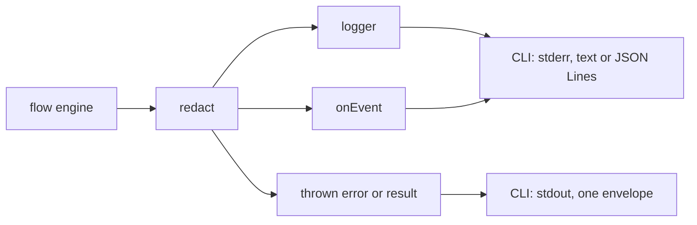
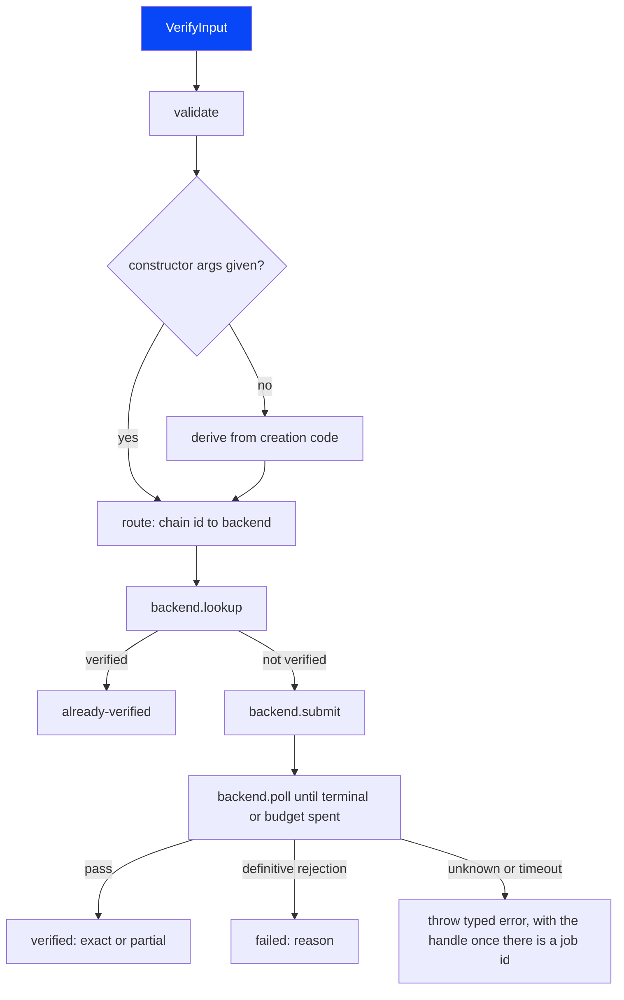
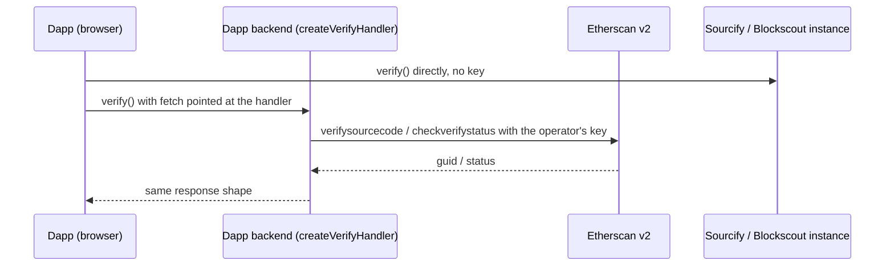

# Architecture

Audience: contributors and agents implementing the library. This is the target design. Sections
marked "proposed" are not decided yet; the decision that settles one updates this page.

Terminology: a _backend_ is one explorer verification API (Etherscan v2, Sourcify and the others).
Its identifier type is `BackendName`.

## Packages

Decided in [decision 0008](decisions/0008-package-split-and-bundle-budget.md): an unscoped core that
also carries the server handler, and scoped add-ons for Node-only code.

| Package                    | Entry points               | Contents                                                                                                        | Runtime                                      |
| -------------------------- | -------------------------- | --------------------------------------------------------------------------------------------------------------- | -------------------------------------------- |
| `explorer-verify`          | `explorer-verify`          | Types, input validation, routing table, backend clients, flow engine                                            | Any (browser, Node, edge)                    |
| `explorer-verify`          | `explorer-verify/server`   | `createVerifyHandler`: the self-hosted handler that holds the Etherscan key. Uses only `Request` and `Response` | Node, edge runtimes and serverless platforms |
| `explorer-verify`          | `explorer-verify/resolve`  | Input resolvers: `resolveInputFromBytecode` (decision 0026)                                                     | Any (browser, Node, edge)                    |
| `@explorer-verify/cli`     | The `explorer-verify` bin  | The command-line interface                                                                                      | Node                                         |
| `@explorer-verify/foundry` | `@explorer-verify/foundry` | Build helper that reads Foundry build-info and emits `VerifyInput` parts                                        | Node                                         |
| `@explorer-verify/hardhat` | `@explorer-verify/hardhat` | Build helper that reads Hardhat 2 and 3 build-info and emits `VerifyInput` parts (decision 0018)                | Node                                         |

The core has no runtime dependencies. Third-party code is vendored under `src/internal/vendor/` with
its licence notice (R-RUN-4). The `verify` entry has a size ceiling checked in CI (R-RUN-3), and
optional features stay out of it (R-RUN-5). `explorer-verify`, `@explorer-verify/foundry` and
`@explorer-verify/hardhat` exist today, and the core has its `/server` and `/resolve` subpaths. The other add-ons arrive in M4. `@explorer-verify/foundry`
depends on the core's public entry point only: it finds and reads a contract's files under `out/`
and leaves every format check to `buildVerifyInput` (R-DX-2).

## Core modules

Planned layout of `packages/explorer-verify/src/`:

| Module                                     | Responsibility                                                                                             |
| ------------------------------------------ | ---------------------------------------------------------------------------------------------------------- |
| `types.ts`                                 | Public types: `VerifyInput`, `VerifyResult`, `VerifyOptions`, `Handle` (exists)                            |
| `backend-names.ts`                         | `BACKEND_NAMES`, `BackendName` (exists)                                                                    |
| `errors.ts`                                | `ExplorerVerifyError` and the code catalogue: hints, docs URLs, key redaction (exists in part)             |
| `input/validate.ts`                        | R-IN-6 checks                                                                                              |
| `input/build.ts`                           | `buildVerifyInput`: detects each document's shape and builds the input (R-IN-7) (exists)                   |
| `input/metadata.ts`                        | Rebuilds Standard JSON from Solidity metadata and checks source hashes (R-IN-7) (exists)                   |
| `input/constructor-args.ts`                | Derives constructor arguments from the creation code (R-IN-3)                                              |
| `input/resolvers/*.ts`                     | Input resolvers: bytecode metadata to Sourcify or IPFS, with the CBOR reader and the CID (R-IN-5) (exists) |
| `routing/table.json`, `routing/resolve.ts` | Chain id to backend, API URL and explorer URL (R-RT)                                                       |
| `backends/<name>.ts`                       | One client per backend, all with the `Backend` interface below (`sourcify.ts`, `etherscan.ts` exist)       |
| `flow/verify.ts`                           | `verify()`: validate, route, check, submit, poll, map the result (R-FLOW)                                  |
| `flow/handle.ts`                           | `parseHandle` of both handle forms; re-exports `formatHandle` from `flow/format-handle.ts` (exists)        |
| `flow/status.ts`                           | `checkStatus(handle)` for resumed polling, on the poll helpers of `flow/verify.ts` (R-FLOW-5) (exists)     |
| `flow/dry-run.ts`                          | `dryRun()`: the steps of `verify()` before the submit, on its helpers (R-AX-8, decision 0029) (exists)     |
| `flow/verify-each.ts`                      | `verifyEach()`: the steps of `verify()` on several backends at once (R-RT-4, decision 0034) (exists)       |
| `http/fetch.ts`                            | Injected `fetch`, retries with backoff, abort, timeout, key redaction in logs                              |
| `http/api-keys.ts`                         | Which options hold keys, which request gets one and where, and the key errors (decision 0016)              |
| `server/handler.ts`                        | `createVerifyHandler`, exported as `explorer-verify/server` (R-SRV) (exists)                               |
| `internal/read-fields.ts`                  | Shared readers for untrusted values: own fields, address, chain id (exists)                                |
| `internal/keccak.ts`                       | Keccak-256 for the source hashes in Solidity metadata (decision 0012) (exists)                             |
| `internal/sha256.ts`                       | SHA-256 for the IPFS hash of the metadata (decision 0026) (exists)                                         |
| `internal/vendor/`                         | Vendored third-party code with its licence notice (R-RUN-4)                                                |

## Backend interface

Every backend client implements the same shape, so the flow engine never branches on the backend.
It lives in `backends/backend.ts` and is internal: the package entry point does not export it.

```ts
interface Backend {
  readonly name: BackendName;
  /** Returns the match when the contract is already verified, or undefined. */
  lookup(target: Target, ctx: Context): Promise<Match | undefined>;
  /** Submits the verification: a handle to poll, or already-verified with its match. */
  submit(input: ResolvedInput, ctx: Context): Promise<SubmitOutcome>;
  /** Polls once; returns "pending" or a terminal outcome. */
  poll(handle: Handle, ctx: Context): Promise<PollOutcome>;
  /** The public page for the contract, or undefined when the route has none. */
  explorerUrl(target: Target, ctx: Context): string | undefined;
}

type Match = "exact" | "partial";
type SubmitOutcome =
  | { state: "submitted"; handle: Handle }
  | { state: "already-verified"; match: Match };
type PollOutcome =
  | { state: "pending" }
  | { state: "verified"; match: Match }
  | { state: "already-verified"; match?: Match }
  | { state: "failed"; reason: string };
```

`Context` holds the route and the HTTP context. The HTTP context carries `fetch`, the
`AbortSignal`, the budget, the keys to redact, the logger and the retry callback. `Context` also
holds the checked `apiKeys`; a client passes each request through `withKey` (`http/api-keys.ts`),
the one rule for which request gets a key and where it goes (decision 0016). A `Handle` is plain
JSON (version, backend name, chain id, address, explorer job id) so `checkStatus` can resume it in
another process. It carries no URL.

Rules every client follows:

- An answer the client does not recognise throws. It never reads as "not verified" or as success
  (R-FLOW-4). `failed` is only for an explorer code that rejects the source for good.
- `already-verified` from `poll` may come without a match; the flow then looks the grade up.
- A job that ended without a verdict throws `verification-inconclusive`, without a handle: polling
  the finished job again gives the same answer ([decision 0011](decisions/0011-verification-inconclusive-error.md)).
- `failed.reason` and every excerpt from the explorer are redacted with the call's keys and cut to
  300 characters.
- `poll` checks the handle's backend and job id before any request.
- A submit that got no response, a 500, 502 or 504, or a success status whose body failed, stalled
  or did not parse may have reached the explorer. The client looks the contract up, returns
  `already-verified` when it is verified, and otherwise submits once more. A second submit that
  finds a job already running throws `in-progress`, without a job id.

The Sourcify client (`backends/sourcify.ts`) is the first one. The answers it maps and their
sources are in [research/2026-11-02-sourcify-v2.md](research/2026-11-02-sourcify-v2.md); the user
view is [docs/user/reference/sourcify.md](../user/reference/sourcify.md).

The Etherscan v2 client (`backends/etherscan.ts`) sends every request as a form-encoded POST with
the key in the body, and maps the `result` text, which comes with HTTP 200 for almost every
answer. The HTTP layer retries its per-second rate-limit answer through `HttpRequest.rateLimited`,
as it retries a 429. `backends/common.ts` holds what both clients share: reading an answer, the
submit that is never sent again blindly, and the handle check. The answers and their sources are in
[research/2026-11-04-etherscan-client.md](research/2026-11-04-etherscan-client.md); the user view is
[docs/user/reference/etherscan.md](../user/reference/etherscan.md).

## Public entry points

Decided in [decision 0009](decisions/0009-options-handle-and-errors.md); the logging parts are
amended by [decision 0010](decisions/0010-logger-fields-events-and-silent-default.md).

- `verify(input: VerifyInput, options?: VerifyOptions): Promise<VerifyResult>` and
  `checkStatus(handle: Handle | string, options?: VerifyOptions): Promise<VerifyResult>`.
- `dryRun(input: VerifyInput, options?: VerifyOptions): Promise<DryRunResult>` validates, routes and
  looks the contract up, then stops before the submit (R-AX-8,
  [decision 0029](decisions/0029-dry-run-in-the-core.md)). It needs no key: where `verify()` would
  throw `missing-api-key`, it sends nothing and returns `lookup: "skipped"`.
- `verifyEach(input: VerifyInput, options: VerifyEachOptions): Promise<VerifyEachResult>` runs the
  steps of `verify()` on several backends in parallel, with one budget, and returns one outcome per
  backend (R-RT-4, [decision 0034](decisions/0034-verify-each-for-several-backends.md)).
- `VerifyOptions` carries `fetch`, `signal`, `timeoutMs` (budget for the whole call),
  `pollIntervalMs`, `logger`, `onEvent`, `route` and `apiKeys`, keyed by backend name (decision
  0016). Every field is optional. M2 adds `rpcUrl`.
- `Handle` is `{ version: 1, backend, chainId, address, jobId }`: plain JSON with no URL.
  `checkStatus` resolves the API from `backend`, `chainId` and the `route` option, never from the
  handle. `parseHandle` reads a handle from untrusted input and rejects unknown fields.
- `validateInput(input: unknown): VerifyInput` checks the input before any request (R-IN-6) and
  returns it normalised: the version without a leading `v`, and the address, constructor
  arguments and creation transaction hash in lower case. The result is a deep copy. It throws
  `invalid-input` with every problem found. `verify()` will call it first.
- `linkLibraries(input: unknown): VerifyInput` validates the input and merges `libraries` into
  `settings.libraries` (R-IN-4). `verify()` does not call it
  ([decision 0025](decisions/0025-library-addresses-not-merged-by-default.md)).
- Every failure throws `ExplorerVerifyError` with `code`, `hint`, `retryable`, `docsUrl` and
  `details`, a union keyed by code. `toJSON()` is the `error` object of the CLI's JSON envelope
  (R-AX-5).
- `exitCodeOf(outcome)` gives the exit code of a result, a `DryRunResult` or an error (R-AX-7), and
  `toEnvelope(outcome)` the versioned JSON envelope (R-AX-5): a result copied field by field or the
  error's `toJSON()`, in a fixed key order, with every string redacted. `schema/envelope.schema.json`
  ships in the package as `explorer-verify/envelope.schema.json`. The CLI and the server handler use
  both, so they cannot disagree.
- A time budget that runs out after the explorer accepted the submission throws `not-confirmed`,
  whose `details.handle` `checkStatus` accepts. One that runs out before then throws a timeout error
  without a handle; its code arrives in #12, and the CLI maps it to exit code 5.
- Abort rejects with `signal.reason` unchanged. `verify()` emits a `verify.submitted` event with
  the handle as soon as the submit is accepted, so an aborted call can still be resumed (R-DX-6).

`types.ts` holds the option and handle types, `errors.ts` the error class, `envelope.ts`
`exitCodeOf` and `toEnvelope`, `flow/handle.ts` `parseHandle` and `formatHandle`,
`input/validate.ts` `validateInput`, `input/libraries.ts` `linkLibraries`, `flow/verify.ts`
`verify`, `flow/status.ts` `checkStatus` and `flow/dry-run.ts` `dryRun`. `dryRun` reuses
`settingsOf`, `routeOf` and `openCall`, with the key check off, and `keyMissing` of
`http/api-keys.ts`. `checkStatus` reuses the option reading, the call setup, the
poll loop, the failure cap, the last lookup and the result mapping of `flow/verify.ts`
(`settingsOf`, `openCall`, `settle`). It polls at once instead of after one interval. Its handle's
backend must equal the backend the route resolves for the handle's chain, or it throws
`invalid-input` before any request (R-SEC-2). When a poll answers that the explorer no longer
knows the job, `settle` looks the contract up once, in the same grace window as the last lookup,
for both functions: a match returns `verified`, otherwise it throws `job-not-found` with the handle.

## Logging and events

Decided in [decision 0010](decisions/0010-logger-fields-events-and-silent-default.md). The core has
two output channels, both optional and both off by default:

- `logger` (R-DX-5): `debug`, `info`, `warn` and `error`, each `(message, fields?)` with flat
  JSON-safe fields. Messages are diagnostics and may change in any release.
- `onEvent` (R-DX-6): typed stage events with stable names, from `verify.validated` to
  `verify.result`. `verify.submitted` carries the handle. Programs read events, not log text.

Every value passes one redaction step before it leaves the core, whether it goes to the logger, to
`onEvent`, into an `ExplorerVerifyError` or into a result. A failure the core throws is not also
logged at `error`.

`src/observe.ts` holds the guard for both channels. `createObserver({ logger, onEvent, secrets })`
returns a `log` and an `emit` that never throw:

- `log` is `redactingLogger` from `src/redact.ts`. It redacts the message and every field name and
  value, and replaces the string value of a field named like a key (`apikey`, `token` and the other
  names the redaction patterns use) whole. It passes a new fields object, and drops a line when the
  caller's method throws or returns a promise that rejects. Without a logger it does nothing.
- `emit` passes `redactEvent(event)`, a frozen copy with only the documented fields, to
  `onEvent`. The address, the API host and the handle's job id are redacted. The job id goes
  through `redactHandleLine` in `src/flow/format-handle.ts`, the rule the envelope also uses, so a
  job id shaped like a key still resumes. Fixed values (`type`, `backend`, `match`, `state`,
  `reason`, `status`) and numbers are copied. When `onEvent` throws, or returns a promise that
  rejects, the first failure is logged at `warn` and later ones are ignored. The event type in that
  warning is read before the callback runs. Without `onEvent` it does nothing.

Rule: one call, one observer. `verify()` and `checkStatus()` create the observer and pass it to
every layer; nothing below them takes a raw logger or callback. `HttpContext.observer` has the
`Observer` type, so the HTTP layer and the backends (through `ctx.http.observer`) log and emit
through the call's observer, and a broken callback is reported once per call.
`schema/event.schema.json` describes the events and ships as `explorer-verify/event.schema.json`.

The diagram shows where each output goes in the CLI.



The core writes to no stream and reads no environment variable. The CLI turns `--quiet`,
`--verbose`, `EXPLORER_VERIFY_LOG` and `--log-format` into a logger and an event callback that write
to stderr (R-AX-14, R-AX-15), and prints the result or the error as one envelope on stdout
(R-AX-5). A browser or server caller passes `console`, its own logger, or an `onEvent` that forwards
to its telemetry. The core has no OpenTelemetry dependency; the event names follow OpenTelemetry's
naming rules, so an `onEvent` callback can emit them as OpenTelemetry events.

## HTTP layer

`http/fetch.ts` exports `request(ctx, req)`, which every backend client calls, and `sleep(ms,
signal)`, which polling uses (R-FLOW-6).

- Every request goes through `ctx.fetch`, or `globalThis.fetch` when it is absent (R-SRV-5). The
  function is called on its own, not as a method of `ctx`, because a browser's `fetch` throws
  "Illegal invocation" when called on another object.
- One attempt is the fetch and the body read. It races the caller's signal and a timer set to the
  per-request timeout (default 30 s) or the budget's deadline, whichever comes first. The signal
  is checked again before each attempt. The returned `Response` holds the body already read, so
  reading it cannot hang, and has no `content-encoding`, `content-length` or `transfer-encoding`
  header.
- Redirects are never followed (R-SEC-2). The request sets `redirect: "manual"`. An opaque
  redirect, a 3xx, a response marked `redirected` or one whose URL has another origin ends the
  call with `unexpected-response`. The last two catch an injected `fetch` that ignores
  `redirect`. The `Location` header is never read, logged or put in an error.
- The body is read chunk by chunk up to `maxResponseBytes` (default 16 MiB, counted after
  decoding). A larger `content-length` fails before the read. A body above the limit, or one that
  fails or stalls after the headers arrived, is `unexpected-response` and is not retried.
- Every timer is clamped to 2,147,483,647 ms, the most `setTimeout` takes. A `requestTimeoutMs`
  or `maxResponseBytes` that is not a positive finite number throws `invalid-input`.
- Retries: at most 5 attempts, backoff from 1 s doubled per attempt with jitter that keeps between
  half and all of each step, and at least the `Retry-After` wait. A `Retry-After` above 30 s, or a
  wait that would reach the deadline, ends the retries with the last failure. Sourcify asks
  clients to back off this way on 429 and 5xx
  ([research](research/2026-11-02-explorer-apis.md#sourcify-api-v2)).
- `retry: "safe"` retries network errors, timeouts, 429, 502, 503 and 504. `retry: "submit"`
  retries only 429 and 503, which refuse a request before the explorer processes it. A submit that
  got no response, timed out, or got a 500, 502 or 504 may have reached the explorer, so it is not
  sent again; the backend checks the contract's state with a lookup before it submits again.
- A 429 whose JSON body has `customCode` `duplicate_verification_request` is returned without a
  retry; the backend maps it to `in-progress`.
- Giving up throws `network` (no response, with `attempts`), `rate-limited` (with `attempts` and
  `retryAfterMs`, at most one hour), `unexpected-response` (a 5xx, with the status, an excerpt and
  `retryAfterMs`) or `timeout` (the budget ran out). Every error gets the call's keys as `secrets`.
- Log lines show the URL's origin and path, with `?REDACTED` for a query, through the redacting
  logger, with `backend`, `method`, `url` and `attempt` as fields. A retry is logged at `warn`,
  with `reason`, `status` (`null` for a network failure) and `delayMs`; a failure that is thrown is
  not logged at `error`. Before each retry wait, `ctx.observer` emits a `verify.retry` event
  with the next attempt number, the reason and the wait (R-DX-6).
- The timers are `setTimeout`, which keeps a Node process alive. `AbortSignal.timeout()` is not
  used: its timer does not keep Node alive (on Node 24.21.0, on 2026-11-02, a script that waits
  only on it exits with code 0 before the abort fires), and the node:test mock timers do not drive
  it. `AbortSignal.any()` is not used either: Safari added it in 17.4
  ([MDN compatibility data](https://developer.mozilla.org/en-US/docs/Web/API/AbortSignal/any_static#browser_compatibility),
  read on 2026-11-02). A unit test runs a child Node process to check that `sleep` keeps it
  alive.

## Routing

`routing/table.json` maps each chain id to its backends, in order of preference (R-RT-1). The
table is schema 2 ([decision 0024](decisions/0024-compact-routing-table.md)): a row has `chainId`
and `backends`, and an entry holds the backend name and only what varies per chain, `network`
for Routescan and an optional `explorer` host for Etherscan v2. The table carries one `checked`
date. It is data, imported as a JSON module with `with { type: "json" }`. The user reference is
[Routing](../user/reference/routing.md).

`tableTarget(chainId, entry)` derives each entry's API base and contract page from fixed
templates, in one place; the Sourcify fallback goes through it too. An entry it cannot derive is
dropped from the row, so its host gets no request and no key.

`resolveRoute(chainId, override, choice)` in `routing/resolve.ts` resolves a call. `choice` holds
the caller's checked keys, `allowSourcifyFallback`, the backends with a client and, in tests, another
table. The flow builds it in `routeOf`, which `verify()` and `checkStatus()` both call, so a resumed
job resolves the same route from the same options.

Without `route.apiUrl`:

- A chain with a row resolves to its first backend that has a client and is usable with the
  caller's keys: one that needs no key, or one with a key in `apiKeys`. Only `etherscan-v2` needs a key. When none is
  usable it takes the first, and the flow's missing-key check throws `missing-api-key`.
  `route.backend` picks another backend the row lists; one it does not list throws
  `unsupported-chain` naming the chain and the backend (R-RT-2).
- A chain with no row resolves to the public Sourcify API when `allowSourcifyFallback` is true
  (R-RT-3). Otherwise it throws `unsupported-chain` with `details.backend` `sourcify`, whose hint
  names the fallback option and the route override.

With `route.apiUrl`, the call goes there for any chain, and the backend is `route.backend` or
`sourcify`. `route.backend` naming a backend with no client throws `invalid-input` before the table
is read. A table that chooses a backend with no client throws `unsupported-chain` when the flow
opens the call, after `checkStatus()` has compared the handle's backend with the route's.

`resolveRoute` checks the override before any request uses it (R-SEC-2):

- `route` must be a plain object, with prototype `Object.prototype` or `null`. Only its own
  `backend`, `apiUrl` and `apiKey` properties are read, each once. Inherited ones are ignored.
- `route.apiUrl` is a primitive string of at most 8192 characters that parses as an absolute URL
  and uses `https:`, or `http:` with the hostname exactly `localhost`, `127.0.0.1` or `[::1]`. The
  check runs on the hostname the URL parser returns, so `localhost.evil.com`, `evil.localhost`,
  `127.0.0.1.nip.io` and `[::ffff:127.0.0.1]` fail. On Node, the system resolver decides where
  `localhost` points.
- It must not hold a user name, a password or a fragment.
- `route.backend` must be a primitive string naming a known backend.

The route keeps the caller's query string apart from the base:

- `apiBase` is the origin and path, with trailing slashes removed and no query.
- `requestUrl(path)` appends an endpoint path, empty or starting with `/`, then the query: the
  caller's query string and, for `etherscan-v2`, `chainid`. The route is the one place that adds
  `chainid`, and it drops any `chainid` of the caller's, in any letter case, so a request never
  goes to another chain. Clients build every request
  URL with it and never append to `apiBase` themselves.
- `redactedApiUrl` is `apiBase` followed by `?REDACTED` when the caller's URL had a query. Only the
  query is redacted. The host and path appear as given, so a key must never go in them.
- `explorerUrl(address)` is the contract page `tableTarget` derives, with the address
  percent-encoded. It is `undefined` when the table knows no page for the backend, and when
  `route.apiUrl` is not the table's URL for the backend and chain: the public page would show a contract verified on a
  self-hosted or local server as not verified, so a result from such a route has no `explorerUrl`
  (R-FLOW-3).
- `overridden` says whether `apiBase` came from `route.apiUrl`. `tableHost` is the host of the
  API base the table derives for the backend and chain, or `undefined` when the table lists none. `keyFor`
  sends a key from `apiKeys` only when the route is not overridden and the request goes to
  `https://<tableHost>` on the default port; an overridden route gets only `route.apiKey`
  (decision 0016).

A bad route throws `invalid-input`. The issues name the field and never repeat the value, and the
error has no `cause`, because the URL parser's error holds the input. The returned route is a
frozen plain object.

The unit tests check the shipped table (`test/helpers/routing-table.ts`): its schema and types;
unique, ascending, positive safe-integer chain ids; known backend names, each once per row, with
only the fields of their format; then, on the URLs `tableTarget` derives, the API host and path of
each backend (`https://api.etherscan.io/v2/api`,
`https://api.routescan.io/v2/network/<mainnet|testnet>/evm/<chainId>/etherscan/api` with the row's
chain id, `https://sourcify.dev/server`) and the contract page; the date; and that no value
matches a redaction pattern. A backend without a host rule cannot appear in the table until its
issue adds one. Other tests check that every backend in the table has a client in this release,
and that the table has a row for every chain of the frozen Etherscan chainlist in the research
data. `scripts/compare-routing-table.ts` compares the table with the live public lists and prints
the differences; it never writes the table. `.github/workflows/routing-table.yml` runs it once a
week and keeps one issue open while differences remain (see [testing.md](testing.md#routing-table-check)).

`pnpm run size` measures the code entries with an empty table and the table's rows as their own
entry, `routing table`. One more entry, `verify with table`, measures the `verify` entry with the
rows ([decision 0023](decisions/0023-routing-table-size-measured-apart.md)). Its ceiling, like the
others, is the measured size plus 20% ([decision 0024](decisions/0024-compact-routing-table.md)).

## Loading the clients

`DEFAULT_DEPENDENCIES` in `flow/verify.ts` holds a loader per backend: a function that imports the
client with a dynamic `import()` and a literal path. `verify()`, `checkStatus()` and `dryRun()`
resolve the route first and start the time budget. Then `withClient()` loads that route's client
and no other, inside `abortWins`, and `openCall()` builds the call with the same budget. The load
ends with `signal.reason` when the signal aborts, or `timeout` when the budget runs out; the
deadline runs on `AbortSignal.timeout`, which fake timers do not drive. A loaded client is kept by
loader, so later calls take it at once. A loader that fails rejects the call with its error,
before any request to an explorer, and is tried again on the next call. Tests pass client objects
in place of loaders.

A bundler that splits code puts each client in its own chunk, so a page downloads only the client
its calls are routed to. `pnpm run size` measures each entry without its clients, each client
chunk on its own under `chunks` in `size-budget.json`, and `verify` once more as one file
([decision 0031](decisions/0031-clients-load-on-demand-and-chunks-measured-apart.md)).

## Verification flow

The flow engine's path from input to one of three results or a thrown error:



## Browser and server use

Keyless backends are called from the browser; Etherscan goes through the dapp's own handler, which
adds the key:



The client code is identical in both paths. Only the injected `fetch` differs (R-SRV-5). The handler
accepts the same request the backend client would send, checks it against its guards (R-SRV-4),
adds the key and forwards it.

## Extension points

| Extension                | How                                                                                                                                              |
| ------------------------ | ------------------------------------------------------------------------------------------------------------------------------------------------ |
| New backend              | New `backends/<name>.ts` implementing `Backend`, a name in `BACKEND_NAMES`, a loader in `DEFAULT_DEPENDENCIES`, a `chunks` ceiling, routing rows |
| New chain                | A row in `routing/table.json`, or a per-call route override                                                                                      |
| New compiler or language | A new member of the `compiler` union, and its mapping in each backend that accepts it (decision 0004)                                            |
| New input source         | A resolver that returns the `compiler` part of `VerifyInput`                                                                                     |
