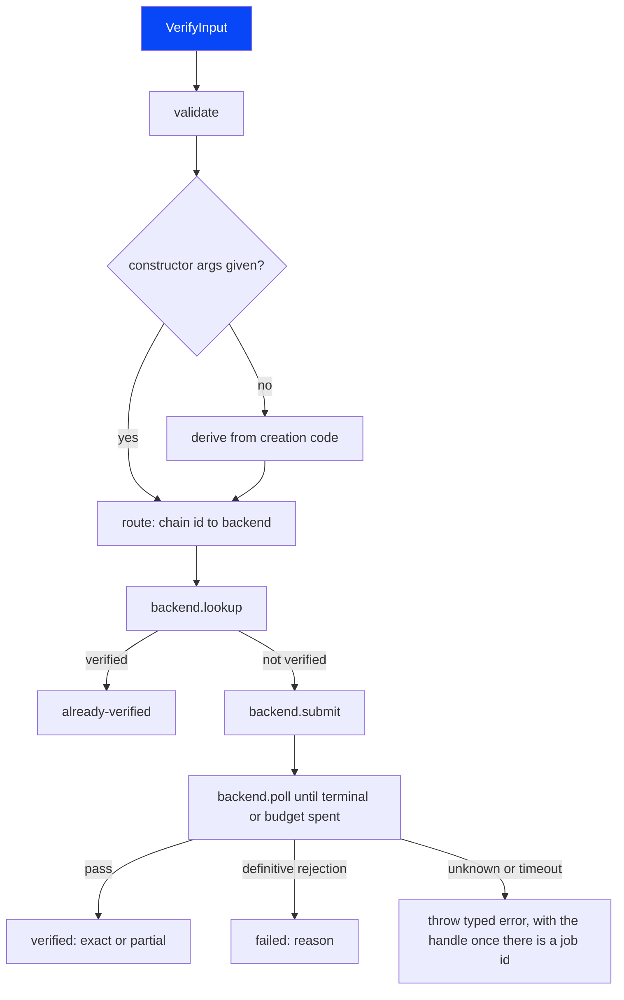
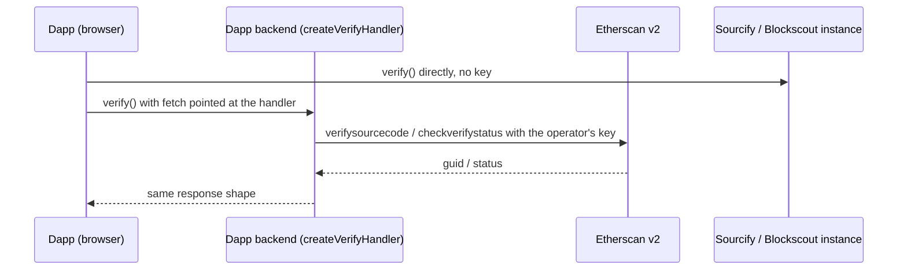

# Architecture

Audience: contributors and agents implementing the library. This is the target design. Sections
marked "proposed" are not decided yet; the decision that settles one updates this page.

Terminology: a _backend_ is one explorer verification API (Etherscan v2, Sourcify and the others).
Its identifier type is `BackendName`.

## Packages

Decided in [decision 0008](decisions/0008-package-split-and-bundle-budget.md): an unscoped core that
also carries the server handler, and scoped add-ons for Node-only code.

| Package                    | Entry points               | Contents                                                                                                        | Runtime                                      |
| -------------------------- | -------------------------- | --------------------------------------------------------------------------------------------------------------- | -------------------------------------------- |
| `explorer-verify`          | `explorer-verify`          | Types, input validation, routing table, backend clients, flow engine, input resolvers                           | Any (browser, Node, edge)                    |
| `explorer-verify`          | `explorer-verify/server`   | `createVerifyHandler`: the self-hosted handler that holds the Etherscan key. Uses only `Request` and `Response` | Node, edge runtimes and serverless platforms |
| `@explorer-verify/cli`     | The `explorer-verify` bin  | The command-line interface                                                                                      | Node                                         |
| `@explorer-verify/foundry` | `@explorer-verify/foundry` | Build helper that reads Foundry build-info and emits `VerifyInput` parts                                        | Node                                         |
| `@explorer-verify/hardhat` | `@explorer-verify/hardhat` | Build helper that reads Hardhat 3 build-info and emits `VerifyInput` parts                                      | Node                                         |

The core has no runtime dependencies. Third-party code is vendored under `src/internal/vendor/` with
its licence notice (R-RUN-4). The `verify` entry has a size ceiling checked in CI (R-RUN-3), and
optional features stay out of it (R-RUN-5). Only `explorer-verify` exists today. The `/server`
subpath arrives in M3, the add-ons in M4.

## Core modules

Planned layout of `packages/explorer-verify/src/`:

| Module                                     | Responsibility                                                                                 |
| ------------------------------------------ | ---------------------------------------------------------------------------------------------- |
| `types.ts`                                 | Public types: `VerifyInput`, `VerifyResult`, `VerifyOptions`, `Handle` (exists)                |
| `backend-names.ts`                         | `BACKEND_NAMES`, `BackendName` (exists)                                                        |
| `errors.ts`                                | `ExplorerVerifyError` and the code catalogue: hints, docs URLs, key redaction (exists in part) |
| `input/validate.ts`                        | R-IN-6 checks                                                                                  |
| `input/constructor-args.ts`                | Derives constructor arguments from the creation code (R-IN-3)                                  |
| `input/resolvers/*.ts`                     | Input resolvers, starting with bytecode metadata to Sourcify or IPFS (R-IN-5)                  |
| `routing/table.json`, `routing/resolve.ts` | Chain id to backend, API URL and explorer URL (R-RT)                                           |
| `backends/<name>.ts`                       | One client per backend, all with the `Backend` interface below                                 |
| `flow/verify.ts`                           | `verify()`: validate, route, check, submit, poll, map the result (R-FLOW)                      |
| `flow/handle.ts`                           | `parseHandle` and the handle's one-line form (exists in part)                                  |
| `flow/status.ts`                           | `checkStatus(handle)` for resumed polling (R-FLOW-5)                                           |
| `http/fetch.ts`                            | Injected `fetch`, retries with backoff, abort, timeout, key redaction in logs                  |
| `server/handler.ts`                        | `createVerifyHandler`, exported as `explorer-verify/server` (R-SRV)                            |
| `internal/vendor/`                         | Vendored third-party code with its licence notice (R-RUN-4)                                    |

## Backend interface

Every backend client implements the same shape, so the flow engine never branches on the backend:

```ts
interface Backend {
  readonly name: BackendName;
  /** Returns the match when the contract is already verified, or undefined. */
  lookup(target: Target, ctx: Context): Promise<"exact" | "partial" | undefined>;
  /** Submits the verification and returns an opaque handle for polling. */
  submit(input: ResolvedInput, ctx: Context): Promise<Handle>;
  /** Polls once; returns "pending" or a terminal outcome. */
  poll(handle: Handle, ctx: Context): Promise<PollOutcome>;
  /** The human-facing page for the contract. */
  explorerUrl(target: Target): string;
}
```

`Context` carries `fetch`, `AbortSignal`, the API key (when the backend needs one), a logger and
the route. A `Handle` is plain JSON (version, backend name, chain id, address, explorer job id) so
`checkStatus` can resume it in another process. It carries no URL.

## Public entry points

Decided in [decision 0009](decisions/0009-options-handle-and-errors.md).

- `verify(input: VerifyInput, options?: VerifyOptions): Promise<VerifyResult>` and
  `checkStatus(handle: Handle, options?: VerifyOptions): Promise<VerifyResult>`.
- `VerifyOptions` carries `fetch`, `signal`, `timeoutMs` (budget for the whole call),
  `pollIntervalMs`, `logger` and `route`. Every field is optional. M2 adds `apiKeys`, keyed by
  backend name, and `rpcUrl`.
- `Handle` is `{ version: 1, backend, chainId, address, jobId }`: plain JSON with no URL.
  `checkStatus` resolves the API from `backend`, `chainId` and the `route` option, never from the
  handle. `parseHandle` reads a handle from untrusted input and rejects unknown fields.
- `validateInput(input: unknown): VerifyInput` checks the input before any request (R-IN-6) and
  returns it normalised: the version without a leading `v` and the address in lower case. It throws
  `invalid-input` with every problem found. `verify()` will call it first.
- Every failure throws `ExplorerVerifyError` with `code`, `hint`, `retryable`, `docsUrl` and
  `details`, a union keyed by code. `toJSON()` is the `error` object of the CLI's JSON envelope
  (R-AX-5).
- A time budget that runs out after the explorer accepted the submission throws `not-confirmed`,
  whose `details.handle` `checkStatus` accepts. One that runs out before then throws a timeout error
  without a handle; its code arrives in #12, and the CLI maps it to exit code 5.
- Abort rejects with `signal.reason` unchanged. `verify()` logs the handle through `logger.info` as
  soon as the submit is accepted, so an aborted call can still be resumed.

`types.ts` holds the option and handle types, `errors.ts` the error class, `flow/handle.ts`
`parseHandle` and `input/validate.ts` `validateInput`. `verify` and `checkStatus` do not exist yet.

## Routing in M1

`routing/resolve.ts` is a stub in M1. `resolveRoute(chainId, override)` sends every chain id to
Sourcify at `https://sourcify.dev/server`, with the explorer page
`https://repo.sourcify.dev/<chainId>/<address>`, and `VerifyOptions.route` can point at another
Sourcify server (R-RT-2). M2 replaces the default with `routing/table.json` (R-RT-1) and adds the
fallback rule of R-RT-3. Until then, every chain resolves.

`resolveRoute` checks the override before any request uses it (R-SEC-2):

- `route` must be a plain object, with prototype `Object.prototype` or `null`. Only its own
  `backend` and `apiUrl` properties are read, each once. Inherited ones are ignored.
- `route.apiUrl` is a primitive string of at most 8192 characters that parses as an absolute URL
  and uses `https:`, or `http:` with the hostname exactly `localhost`, `127.0.0.1` or `[::1]`. The
  check runs on the hostname the URL parser returns, so `localhost.evil.com`, `evil.localhost`,
  `127.0.0.1.nip.io` and `[::ffff:127.0.0.1]` fail. On Node, the system resolver decides where
  `localhost` points.
- It must not hold a user name, a password or a fragment.
- `route.backend` must be a primitive string naming a known backend, and in M1 only `sourcify`
  passes.

The route keeps the caller's query string apart from the base:

- `apiBase` is the origin and path, with trailing slashes removed and no query.
- `requestUrl(path)` appends an endpoint path that starts with `/`, then adds the caller's query
  string again. Clients build every request URL with it and never append to `apiBase` themselves.
- `redactedApiUrl` is `apiBase` followed by `?REDACTED` when there was a query. Only the query is
  redacted. The host and path appear as given, so a key must never go in them. A key goes in the
  query string, or in the per-backend key option planned for M2.
- `explorerUrl` is `undefined` when the override changes the API base. The public repository page
  would show a contract verified on a self-hosted or local server as not verified, so a result
  from such a route has no `explorerUrl` (R-FLOW-3).

A bad route throws `invalid-input`. The issues name the field and never repeat the value, and the
error has no `cause`, because the URL parser's error holds the input. The returned route is a
frozen plain object.

## Verification flow

The flow engine's path from input to one of three results or a thrown error:



## Browser and server use

Keyless backends are called from the browser; Etherscan goes through the dapp's own handler, which
adds the key:



The client code is identical in both paths. Only the injected `fetch` differs (R-SRV-5). The handler
accepts the same request the backend client would send, checks it against its guards (R-SRV-4),
adds the key and forwards it.

## Extension points

| Extension                | How                                                                                                   |
| ------------------------ | ----------------------------------------------------------------------------------------------------- |
| New backend              | New `backends/<name>.ts` implementing `Backend`, a name in `BACKEND_NAMES`, routing rows              |
| New chain                | A row in `routing/table.json`, or a per-call route override                                           |
| New compiler or language | A new member of the `compiler` union, and its mapping in each backend that accepts it (decision 0004) |
| New input source         | A resolver that returns the `compiler` part of `VerifyInput`                                          |
